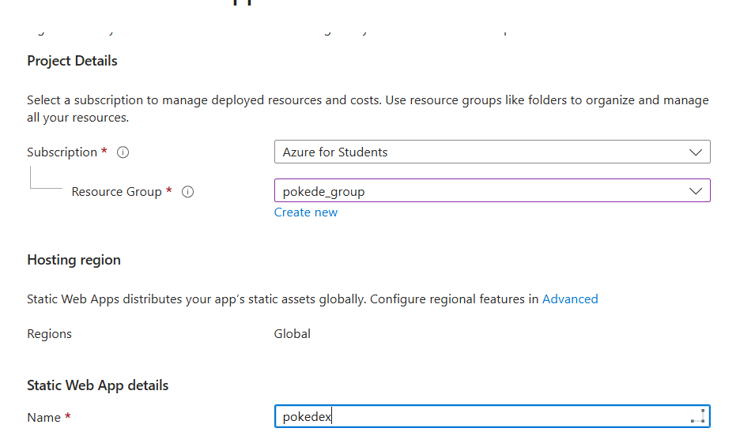
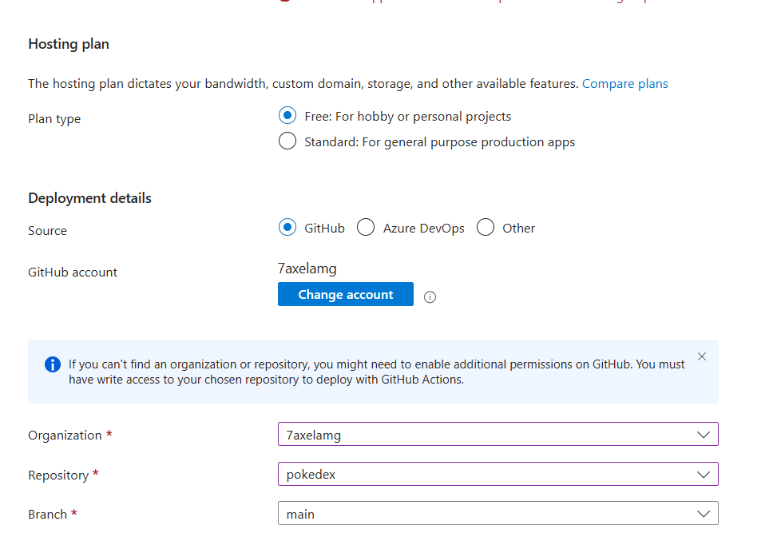
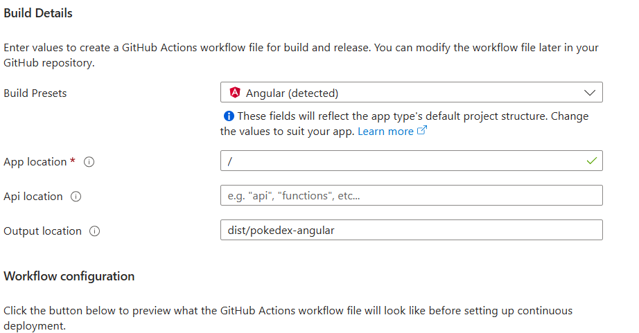
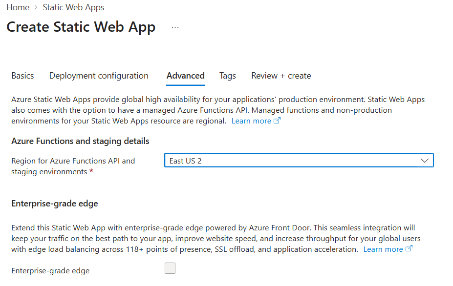
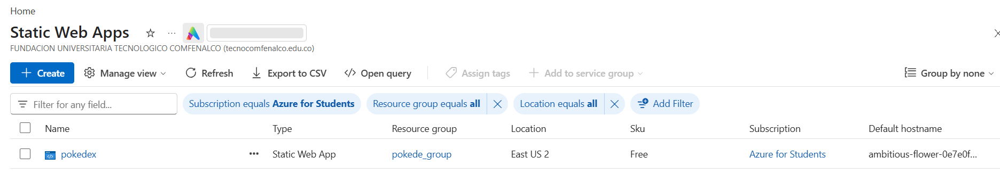
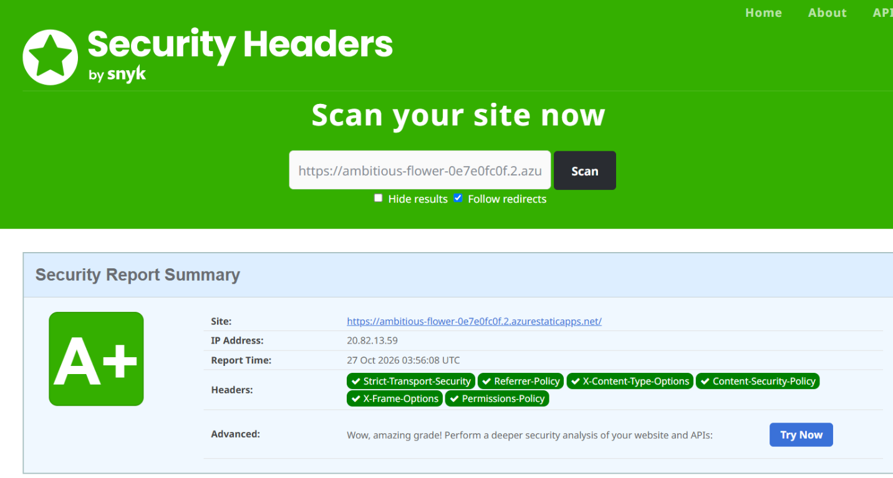

# Despliegue de Pokédex en Azure

En esta guía dejo los pasos que seguí para publicar la aplicación en Azure Static Web Apps. El despliegue queda conectado con GitHub, así que Azure vuelve a compilar y publicar la página cuando hay cambios en la rama `main`.

## 1. Antes de empezar

- Tener acceso a una cuenta de [Azure for Students](https://azure.microsoft.com/free/students/).
- Tener el proyecto en GitHub. En este caso usé la organización `7axelamg` y el repositorio `pokedex`.
- Revisar en el portal de Azure qué regiones permite la suscripción. En mi caso, el recurso quedó en **East US 2**.

Para activar la cuenta de estudiante, inicié sesión en Azure, completé la verificación que me solicitó Microsoft y confirmé en el [portal de Azure](https://portal.azure.com/) que apareciera la suscripción **Azure for Students**. La activación y la elegibilidad dependen de los requisitos vigentes de Microsoft.

## 2. Crear la Static Web App

1. En el portal de Azure, busqué **Static Web Apps** y seleccioné **Create**.
2. En los detalles del proyecto, elegí la suscripción **Azure for Students**, el grupo de recursos `pokede_group` y escribí `pokedex` como nombre de la aplicación.
3. Dejé la región de alojamiento de Static Web Apps como global, tal como la muestra Azure. La aplicación usa el plan **Free**, suficiente para este proyecto.



## 3. Conectar el repositorio de GitHub

1. En **Deployment details**, seleccioné **GitHub** como origen.
2. Autoricé a Azure para conectarse con GitHub y seleccioné estos datos:
   - **Organization:** `7axelamg`
   - **Repository:** `pokedex`
   - **Branch:** `main`
3. Si el repositorio no aparece, hay que revisar los permisos de GitHub y dar acceso al repositorio elegido.



## 4. Indicar cómo se compila Angular

En **Build Details**, Azure detectó Angular. Dejé los campos así:

| Campo | Valor |
|---|---|
| **Build preset** | Angular (detected) |
| **App location** | `/` |
| **Api location** | Vacío |
| **Output location** | `dist/pokedex-angular` |



Azure usa estos valores para crear un workflow de GitHub Actions. Revisé la configuración propuesta y luego continué con la creación del recurso.

## 5. Revisar las opciones avanzadas y crear

En la pestaña **Advanced**, elegí **East US 2** para la región de Azure Functions y los entornos de prueba. Dejé desactivada la opción **Enterprise-grade edge**, porque no la necesito para este proyecto.



Por último, revisé los datos en **Review + create** y seleccioné **Create**. Azure tardó unos minutos en preparar el recurso y el workflow.

## 6. Comprobar que quedó publicado

1. En el recurso de Static Web Apps, esperé a que terminara el despliegue.
2. En GitHub, abrí la pestaña **Actions** del repositorio y comprobé que el workflow terminara sin errores.
3. Abrí la dirección pública y probé la página principal:
   <https://ambitious-flower-0e7e0fc0f.2.azurestaticapps.net/>
4. En la lista de Static Web Apps del portal, confirmé que apareciera `pokedex` con el plan **Free**.



## 7. Configuración de rutas y encabezados

El archivo [src/staticwebapp.config.json](./src/staticwebapp.config.json) configura los encabezados HTTP y las rutas de Azure Static Web Apps. Además, `angular.json` incluye ese archivo en los assets de compilación para que llegue a la raíz del sitio publicado.

La aplicación se sirve desde la raíz del dominio y las imágenes se encuentran en `/assets/images`. La opción `navigationFallback` devuelve `index.html` cuando se abre o se recarga una ruta interna de Angular; así, una dirección de detalle no termina en un 404.

Los encabezados configurados son:

- **Content-Security-Policy (CSP):** limita desde dónde se pueden cargar scripts, estilos, imágenes, fuentes y conexiones.
- **Strict-Transport-Security (HSTS):** indica al navegador que use HTTPS durante el periodo especificado.
- **X-Content-Type-Options:** evita que el navegador interprete un archivo como un tipo distinto al declarado.
- **X-Frame-Options:** impide que otro sitio incruste la aplicación en un frame.
- **Referrer-Policy:** controla qué información de referencia se envía al navegar a otros sitios.
- **Permissions-Policy:** deshabilita cámara, micrófono y geolocalización, que la aplicación no necesita.

La CSP permite estilos inline porque Angular puede insertar estilos de componentes durante la ejecución, pero no permite scripts inline. Si se bloquea un recurso que la aplicación necesita, se puede revisar la consola del navegador y ajustar la directiva correspondiente.

## 8. Probar el sitio y revisar los encabezados

Después del despliegue, comprobé la página pública, el listado y los detalles de Pokémon. También revisé que cargaran las imágenes y que al recargar directamente una ruta de detalle no apareciera un error 404.

Para consultar los encabezados desde PowerShell, ejecuté:

```powershell
curl.exe -I https://ambitious-flower-0e7e0fc0f.2.azurestaticapps.net/
```

La respuesta debe incluir `Content-Security-Policy`, `Strict-Transport-Security`, `X-Content-Type-Options`, `X-Frame-Options`, `Referrer-Policy` y `Permissions-Policy`.

## 9. Revisar el resultado en SecurityHeaders.com

1. Abrí [SecurityHeaders.com](https://securityheaders.com/).
2. Analicé la dirección pública de la aplicación.
3. Guardé la captura del resultado para dejar evidencia de la revisión.

En el análisis más reciente, del **27 de octubre de 2026 a las 03:56:08 UTC**, el sitio obtuvo una calificación **A+**. El reporte muestra como presentes los seis encabezados revisados: HSTS, Referrer-Policy, X-Content-Type-Options, Content-Security-Policy, X-Frame-Options y Permissions-Policy.



La calificación corresponde a la fecha y hora que aparecen en la captura. Puede cambiar si se modifica la configuración o si SecurityHeaders.com actualiza sus criterios.

## Ejecutar el proyecto localmente

Desde la carpeta del proyecto, instalé las dependencias y levanté la aplicación con:

```powershell
npm ci
npm start
```

Normalmente queda disponible en <http://localhost:4200/>. Para generar una compilación de producción:

```powershell
npm run build
```
